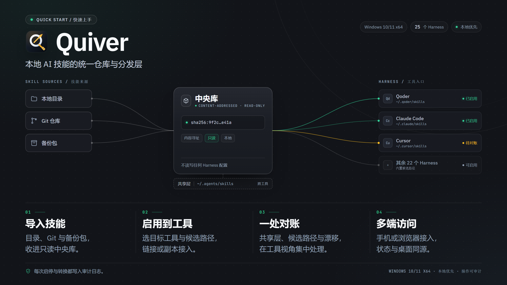
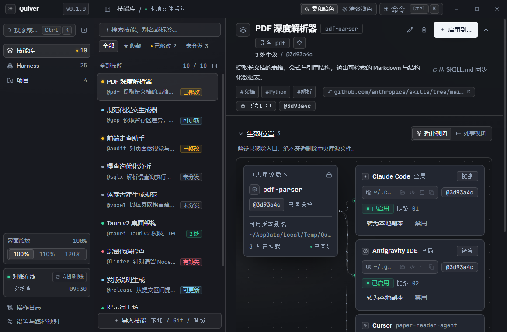
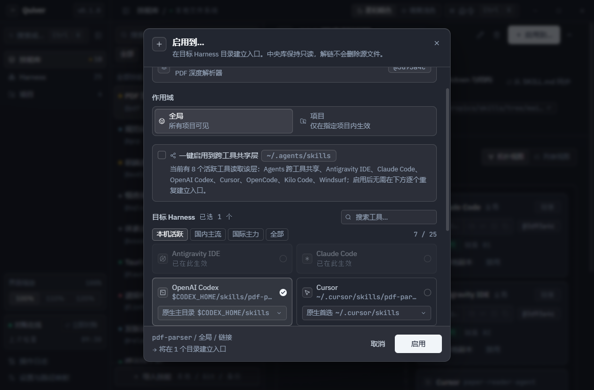
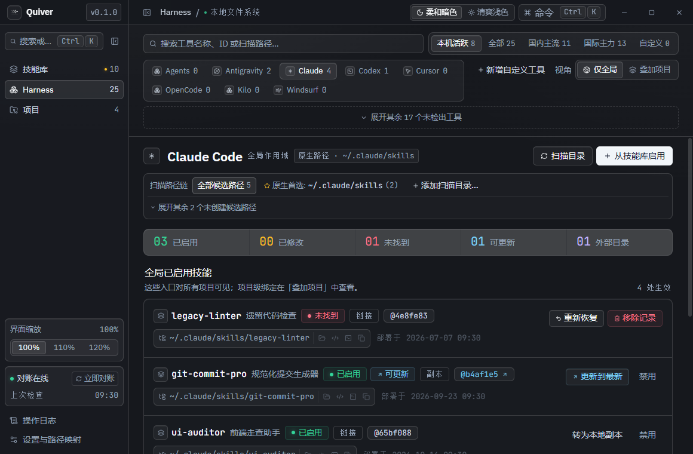
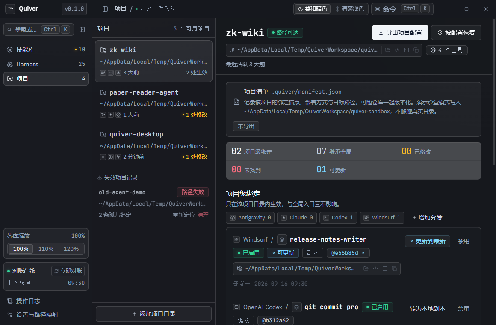
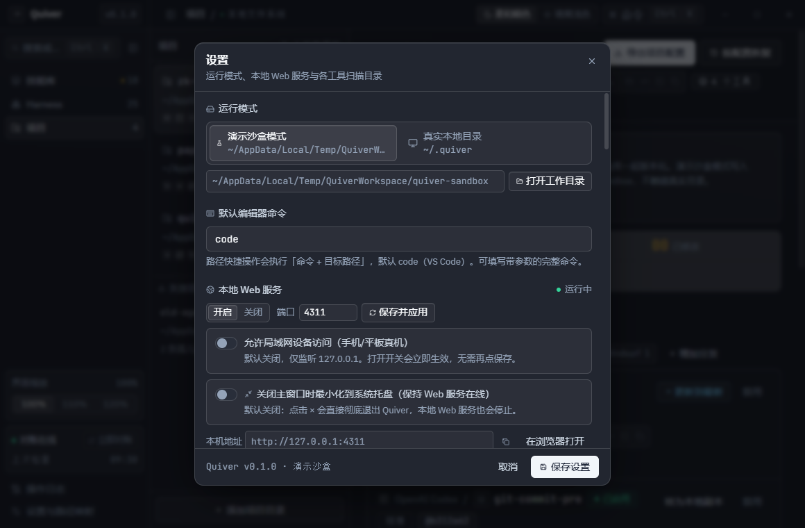
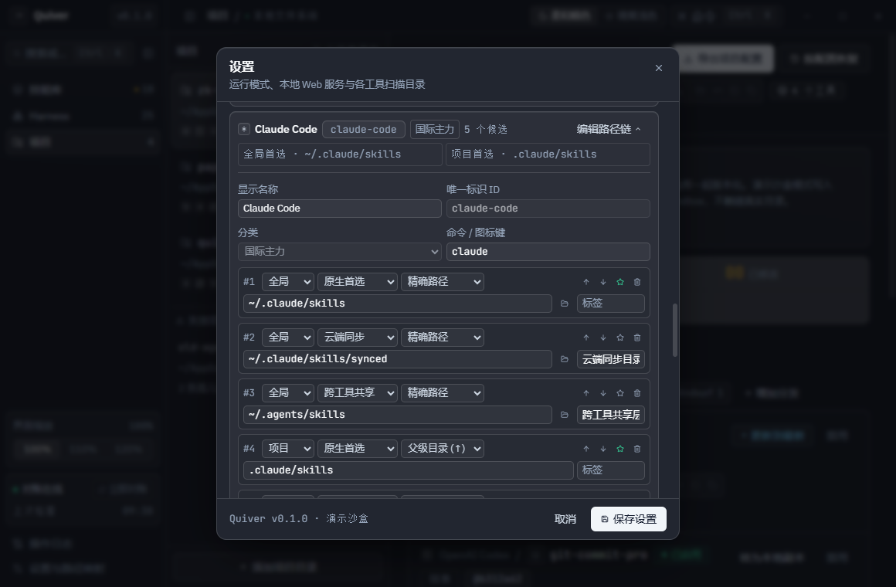
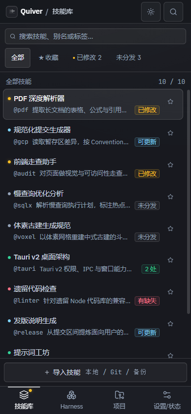
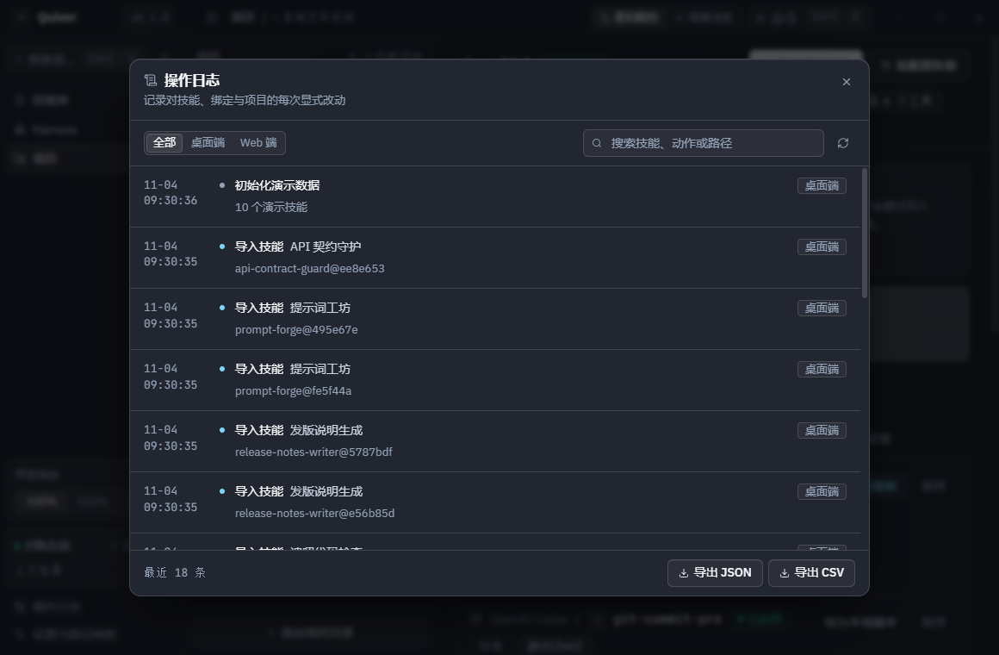

<div align="center">
  
  <h1>Quiver</h1>
  <p><strong>把 AI Skill 收进一个只读箭袋，一处整理，多端分发。</strong></p>
  <p>本地优先的 Skill 管理器 · 内置 25 个 Harness 字典，为 Claude Code、Codex、Cursor、Windsurf、Cline、Antigravity、Qoder、Trae 等而设计</p>
  <p>
    
    
    
    
    
  </p>
  <p>
    <a href="docs/QUICKSTART.md"><strong>快速上手</strong></a> ·
    <a href="https://github.com/blackteaYES/quiver/releases">下载</a> ·
    <a href="assets/SPEC.md">设计规格</a>
  </p>
</div>

---

## 界面预览



先看四步总览：导入技能 → 启用到工具 → 一处对账 → 多端访问。完整操作见 **[快速上手](docs/QUICKSTART.md#四步总览)**。



技能库、Harness 与项目共享同一份绑定数据：中央库只读，入口可追踪、可回滚。安装、导入、启用、漂移处理与手机访问的完整流程见 **[快速上手](docs/QUICKSTART.md)**。

<details>
<summary>查看更多界面截图</summary>

### 启用到多个工具



### Harness 候选路径链



### 项目视角



### 设置与 Harness 路径字典





### 手机浏览器访问



### 操作日志



</details>

## 为什么需要 Quiver

同一个 Skill，很快会散落在多个 coding harness 的扫描目录里：Claude Code 有一份，Cursor 有一份，项目里还有一份。复制得越多，版本越难对齐；改了一个副本，其他副本无声漂移；想清理时又分不清哪个是源头、哪个是入口。

Quiver（箭袋）只做一件事：**把「技能内容」与「部署关系」分开管理**。

- 技能内容进入中央库，按内容哈希寻址，入口天然去重。
- Harness 目录里只放 junction / symlink，或显式创建的独立副本。
- 所有部署关系记录在 `bindings` 中，真实文件状态由对账引擎持续校准。
- 本地修改不会被偷偷写回中央库；重置、收编、忽略都必须由你显式选择。

## 核心能力

| 能力 | 说明 |
| :--- | :--- |
| 三视图 | 技能库、Harness、项目共享同一份 `bindings` 数据，只是三种切片 |
| 25 项工具字典 | 共享层 1 + 国内主流 11 + 国际主力 13；支持本机活跃 / 全部 / 分类筛选与未检出收缩 |
| 候选路径链 | 每个工具可配置多条有序全局 / 项目扫描路径，支持父级目录与 monorepo 子包发现，自动迁移旧配置 |
| 跨工具共享 | `~/.agents/skills` 一次启用、多工具同时可见；禁用时可「智能拆分」或「从共享目录彻底移除」 |
| 自定义工具 | 自动生成英文 ID，编辑候选链、优先级、首选路径，可恢复默认路径链或删除 |
| 收藏与筛选 | 星标置顶并同步到启用对话框；`全部 / ★ 收藏 / 已修改 / 未分发` 快速筛选 |
| 内容寻址 | 每个版本以目录树 SHA-256 命名，相同内容只存一份 |
| 只读中央库 | Store 目录 `0555`、文件 `0444`，从文件系统层面阻止误改 |
| 链接分发 | `link` 模式使用 junction / symlink，`copy` 模式创建独立副本 |
| 安全解链 | 禁用只移除入口本身，绝不递归穿透到中央库源目录 |
| 漂移裁决 | 已修改状态只做标记，重置 / 收编 / 忽略三选一，全部显式触发 |
| 本地副本 | `link` 绑定可原地转为可写副本，缺失入口可从技能库重新部署 |
| 依赖保护 | `depends_on` 声明依赖关系，禁用被依赖技能前先确认 |
| 项目复活 | 项目路径移走后标记「路径失效」，30s 巡检自动重挂并提示 |
| 操作审计 | 桌面端与 Web 端的所有写操作都有中文审计记录，可筛选与导出 |
| 完整备份 | 技能、全部只读版本、依赖声明与全局绑定可完整导出 / 导入 |
| 多端 Web | 桌面窗口之外，可在平板、手机的浏览器里使用完整界面 |
| 托盘驻留 | 可选：关闭窗口时隐藏到系统托盘并保持 Web 服务在线，默认关闭 |

## 架构

```text
+---------------------------------------------------------------------+
|  React 19 + Vite 8 渲染层                                             |
|  技能库 · Harness · 项目 · 设置/状态 · 操作日志                       |
+----------------------+-----------------------------+----------------+
                       | window.quiver (IPC)         | fetch + SSE
+----------------------v-----------------+  +--------v----------------+
|  Electron 主进程                      |  |  本地 HTTP 服务          |
|  窗口 / 原生对话框 / 编辑器 / 终端    |  |  127.0.0.1 或 0.0.0.0    |
|  preload 白名单                       |  |  X-Quiver-Token · SSE    |
+----------------------+-----------------+  +--------+----------------+
                       |                             |
+----------------------v-----------------------------v----------------+
|  Engine                                                             |
|  SQLite (node:sqlite) · Reconciler · chokidar · 30s watchdog         |
+------------+-------------------+--------------------+----------------+
             |                   |                    |
   +---------v--------+  +-------v---------+  +-------v--------------+
   | store/sha256/    |  | available/      |  | Harness 扫描目录     |
   | 0555 / 0444      |  | 版本别名链接    |  | junction / symlink   |
   | 内容寻址只读库    |  |                 |  | 或独立副本           |
   +------------------+  +-----------------+  +----------------------+
```

单一事实来源是 `engine.snapshot()`。渲染层不维护业务副本，也不做乐观写入；每个动作返回结果与最新快照，文件监听与 30s 巡检负责把物理世界的变化带回来。

## 三视图

### 技能库：以技能为主体

- Master-detail 布局，支持搜索、标签、别名与备注；别名胶囊和备注摘要显示在列表第二行。
- 左侧导航与技能列表的右边缘均可拖动调宽，双击分隔条收起，宽度记忆在 `localStorage`（`quiver.navWidth` / `quiver.listWidth`），恢复时回到上次宽度。
- 星标收藏置顶，并可用 `全部 / ★ 收藏 / 已修改 / 未分发` 筛选；「已修改」黄点只在存在漂移绑定时出现。
- 右侧详情展示技能的生效拓扑：哪个 Harness、全局还是项目、版本锚点与对账状态。
- 版本历史可切换激活版本；`link` 绑定会跟随锚点，`copy` 绑定需要显式更新。
- 窄容器自动切换为列表视图，仍可手动切回拓扑。

### Harness：以工具为主体

- 内置 25 项工具字典，按「本机活跃（默认）/ 全部 / 国内主流 / 国际主力 / 自定义」筛选；未检出的工具折叠在「展开其余 N 个未检出工具」之后。
- 每个工具维护有序候选路径链：全局 / 项目作用域、首选 / 共享 / 兼容 / 同步角色、精确 / 父级目录 / monorepo 子包发现方式；设置中可编辑、排序、设为首选或恢复默认。
- 同一技能出现在多条候选目录时按优先级遮蔽：最高者标记「当前生效」，其余标记「被高优先级同名目录覆盖」。
- 共享层（`~/.agents/skills` 与项目 `.agents/skills`）一次启用即可被多个工具读取；禁用时显式选择「仅在当前工具停用（智能拆分）」或「从共享目录彻底移除（所有共用工具同步停用）」。
- 查看某个工具全局启用了哪些技能，或按项目叠加查看「全局生效 + 项目生效」。
- 扫描工具目录，识别不由 Quiver 创建的外部技能（`unmanaged`）；支持多选后批量「收编到技能库」或「原地登记」，前者把原目录替换为 Store 链接，后者保留真实目录并建立副本绑定。
- 不读取、不修改任何 Harness 自己的配置文件。

### 自定义工具与候选路径配置

1. 在「设置 → Harness 字典」点击「新增自定义工具」，填写名称、命令与分类。`id` 会自动转为英文连字符；至少保留一条全局候选，默认勾选自动共享时追加 `~/.agents/skills` 与 `.agents/skills`。
2. 为现有工具追加扫描目录：选择作用域（全局 / 项目）、角色（`primary / shared / compat / synced / custom`）、发现方式（精确 / 父级链 / 子包）与标签。全局路径支持绝对路径、`~` 与 `$ENV`；项目路径必须是安全的相对路径，拒绝 `..` 越界。
3. 调整顺序：编辑器中的 ↑ / ↓ 只改变候选数组顺序，保存时引擎按数组下标重写 `priority`（0 起）。`P0` 是新绑定与启用对话框的默认候选；已有绑定通过 `candidate_id` 锚定，单纯重排不会强制迁移，修改该候选路径或恢复默认会触发自动重挂。
4. 恢复默认：内置工具可「恢复默认路径链」，只重置该工具的候选数组并重挂受影响绑定；自定义工具与其他工具配置不受影响。
5. 删除保护：仍有生效绑定的工具或候选路径不能删除，会中文提示先停用；内置工具删除后写入 `removed_harnesses`，可再次保存配置恢复。
6. 保存后 `config.toml` 完整回读 `id / 名称 / 命令 / 分类 / 候选 / role / discovery / label / priority / removed_harnesses / editor_command`；旧 `global_path` / `project_rel_path` 仅作为首选候选的兼容投影。

### 完整候选路径矩阵

`P` 为 `priority`（越小越优先）；`role` 取 `primary / shared / compat / synced / custom`，表中「父级链」「子包」对应 `parent-chain` / `nested-monorepo`。内置字典共 25 个工具、126 条候选，与 `electron/engine/harnesses.cjs` 逐项一致。

| Harness ID | 显示名称 | 分类 | 全局候选（按优先级） | 项目候选（按优先级） |
| --- | --- | --- | --- | --- |
| `agents-common` | Agents 跨工具共享 | shared | P0 · primary · `~/.agents/skills` · 跨工具共享层 | P1 · primary · `.agents/skills` · 跨工具共享层 |
| `qoder` | Qoder | domestic | P0 · primary · `~/.qoder/skills`<br>P1 · primary · `~/.qoderwork/skills` · QoderWork 变体<br>P2 · shared · `~/.agents/skills` · 跨工具共享层 | P3 · primary · `.qoder/skills`<br>P4 · compat · `.qoderwork/skills`<br>P5 · shared · `.agents/skills` · 跨工具共享层 |
| `qoder-cn` | Qoder CN | domestic | P0 · primary · `~/.qoder-cn/skills`<br>P1 · primary · `~/.lingma/skills` · Lingma 变体<br>P2 · compat · `~/.tonyi/skills`<br>P3 · shared · `~/.agents/skills` · 跨工具共享层 | P4 · primary · `.qoder-cn/skills`<br>P5 · primary · `.lingma/skills` · Lingma 变体<br>P6 · shared · `.agents/skills` · 跨工具共享层 |
| `workbuddy` | WorkBuddy | domestic | P0 · primary · `~/.workbuddy/skills`<br>P1 · primary · `~/.workbuddy/connectors/skills` · Connectors 目录<br>P2 · compat · `~/.codebuddy/skills`<br>P3 · shared · `~/.agents/skills` · 跨工具共享层 | P4 · primary · `.codebuddy/skills`<br>P5 · compat · `.workbuddy/skills`<br>P6 · shared · `.agents/skills` · 跨工具共享层 |
| `deepseek-harness` | DeepSeek Harness | domestic | P0 · primary · `~/.dsh/skills`<br>P1 · compat · `~/.deepseek/skills`<br>P2 · shared · `~/.agents/skills` · 跨工具共享层 | P3 · primary · `.dsh/skills`<br>P4 · compat · `.deepseek/skills`<br>P5 · shared · `.agents/skills` · 跨工具共享层 |
| `trae` | Trae | domestic | P0 · primary · `~/.trae/skills`<br>P1 · shared · `~/.agents/skills` · 跨工具共享层 | P2 · primary · `.trae/skills`<br>P3 · shared · `.agents/skills` · 跨工具共享层 |
| `trae-cn` | Trae CN | domestic | P0 · primary · `~/.trae-cn/skills`<br>P1 · compat · `~/.trae/skills`<br>P2 · compat · `~/.mars/skills`<br>P3 · shared · `~/.agents/skills` · 跨工具共享层 | P4 · primary · `.trae-cn/skills`<br>P5 · compat · `.trae/skills`<br>P6 · shared · `.agents/skills` · 跨工具共享层 |
| `comate` | Comate | domestic | P0 · primary · `~/.comate/skills`<br>P1 · compat · `~/.zulu/skills`<br>P2 · shared · `~/.agents/skills` · 跨工具共享层 | P3 · primary · `.comate/skills`<br>P4 · compat · `.zulu/skills`<br>P5 · shared · `.agents/skills` · 跨工具共享层 |
| `codegeex` | CodeGeeX | domestic | P0 · primary · `~/.codegeex/skills`<br>P1 · shared · `~/.agents/skills` · 跨工具共享层 | P2 · primary · `.codegeex/skills`<br>P3 · shared · `.agents/skills` · 跨工具共享层 |
| `iflycode` | 讯飞星火 Code | domestic | P0 · primary · `~/.iflycode/skills`<br>P1 · shared · `~/.agents/skills` · 跨工具共享层 | P2 · primary · `.iflycode/skills`<br>P3 · shared · `.agents/skills` · 跨工具共享层 |
| `joycoder` | JoyCoder | domestic | P0 · primary · `~/.joycoder/skills`<br>P1 · shared · `~/.agents/skills` · 跨工具共享层 | P2 · primary · `.joycoder/skills`<br>P3 · shared · `.agents/skills` · 跨工具共享层 |
| `fittencode` | Fitten Code | domestic | P0 · primary · `~/.fittencode/skills`<br>P1 · shared · `~/.agents/skills` · 跨工具共享层 | P2 · primary · `.fittencode/skills`<br>P3 · shared · `.agents/skills` · 跨工具共享层 |
| `antigravity` | Antigravity IDE | global | P0 · primary · `~/.gemini/antigravity/skills`<br>P1 · compat · `~/.gemini/config/skills`<br>P2 · shared · `~/.agents/skills` · 跨工具共享层 | P3 · primary · `.agents/skills` · 跨工具共享层<br>P4 · compat · `.agent/skills` |
| `claude-code` | Claude Code | global | P0 · primary · `~/.claude/skills`<br>P1 · synced · `~/.claude/skills/synced` · 云端同步目录<br>P2 · shared · `~/.agents/skills` · 跨工具共享层 | P3 · primary · `.claude/skills` · 父级链<br>P4 · shared · `.agents/skills` · 跨工具共享层 |
| `codex` | OpenAI Codex | global | P0 · primary · `$CODEX_HOME/skills` · 原生主目录<br>P1 · primary · `~/.codex/skills`<br>P2 · shared · `~/.agents/skills` · 跨工具共享层 | P3 · primary · `.codex/skills` · 父级链<br>P4 · shared · `.agents/skills` · 跨工具共享层 |
| `cursor` | Cursor | global | P0 · primary · `~/.cursor/skills`<br>P1 · shared · `~/.agents/skills` · 跨工具共享层 | P2 · primary · `.cursor/skills` · 子包<br>P3 · shared · `.agents/skills` · 子包 · 跨工具共享层 |
| `opencode` | OpenCode | global | P0 · primary · `~/.config/opencode/skills`<br>P1 · compat · `~/.opencode/skills`<br>P2 · compat · `~/.claude/skills`<br>P3 · shared · `~/.agents/skills` · 跨工具共享层 | P4 · primary · `.opencode/skills`<br>P5 · compat · `.claude/skills`<br>P6 · shared · `.agents/skills` · 跨工具共享层 |
| `cline` | Cline | global | P0 · primary · `~/.cline/skills`<br>P1 · compat · `~/.cline/rules`<br>P2 · shared · `~/.agents/skills` · 跨工具共享层 | P3 · primary · `.clinerules/skills` · 子包<br>P4 · compat · `.cline/skills`<br>P5 · shared · `.agents/skills` · 跨工具共享层 |
| `roo-code` | Roo Code | global | P0 · primary · `~/.roo/skills`<br>P1 · shared · `~/.agents/skills` · 跨工具共享层 | P2 · primary · `.roo/skills` · 子包<br>P3 · shared · `.agents/skills` · 跨工具共享层 |
| `kilo-code` | Kilo Code | global | P0 · primary · `~/.kilo/skills`<br>P1 · compat · `~/.kilocode/skills`<br>P2 · compat · `~/.claude/skills`<br>P3 · shared · `~/.agents/skills` · 跨工具共享层 | P4 · primary · `.kilo/skills`<br>P5 · compat · `.kilocode/skills`<br>P6 · compat · `.claude/skills`<br>P7 · shared · `.agents/skills` · 跨工具共享层 |
| `gemini-cli` | Gemini CLI | global | P0 · primary · `~/.gemini/skills`<br>P1 · compat · `~/.gemini/config/skills`<br>P2 · shared · `~/.agents/skills` · 跨工具共享层 | P3 · primary · `.gemini/skills`<br>P4 · shared · `.agents/skills` · 跨工具共享层 |
| `windsurf` | Windsurf | global | P0 · primary · `~/.codeium/windsurf/skills`<br>P1 · shared · `~/.agents/skills` · 跨工具共享层 | P2 · primary · `.windsurf/skills`<br>P3 · shared · `.agents/skills` · 跨工具共享层 |
| `github-copilot` | GitHub Copilot | global | P0 · primary · `~/.copilot/skills`<br>P1 · shared · `~/.agents/skills` · 跨工具共享层 | P2 · primary · `.github/skills`<br>P3 · shared · `.agents/skills` · 跨工具共享层 |
| `kiro` | Kiro | global | P0 · primary · `~/.kiro/skills`<br>P1 · shared · `~/.agents/skills` · 跨工具共享层 | P2 · primary · `.kiro/skills`<br>P3 · shared · `.agents/skills` · 跨工具共享层 |
| `goose` | Goose | global | P0 · primary · `~/.config/goose/skills`<br>P1 · shared · `~/.agents/skills` · 跨工具共享层 | P2 · primary · `.goose/skills`<br>P3 · shared · `.agents/skills` · 跨工具共享层 |

### 同名遮蔽与跨工具共享解绑

- 同一 `slug` 在同一作用域出现多次时，按候选 `priority` 决定生效入口（更小者优先），其余标记「被高优先级同名目录覆盖」；共享层条目标注可见读者数量。
- 共享层禁用必须显式二选一：「仅在当前工具停用（智能拆分）」会删除共享入口，并把技能重挂到其他活跃读者的首选目录；没有可用候选的工具会跳过。「从共享目录彻底移除」会删除共享入口并停用所有共用工具绑定。两种动作都不改动 `store/` 与 `available/` 中的源内容，也不影响旁观技能。

### 项目：以项目为主体

- 汇总项目内所有绑定，并展示项目级与全局入口的真实物理关系。
- 项目移走或外接盘拔出时显示「路径失效」与孤儿绑定；路径恢复后自动重挂。
- 可显式导出 `.quiver/manifest.json`，或按 manifest 恢复项目；默认不在项目中创建任何文件。

## 只读中央库与安全防线

### 内容寻址、只读固化

导入时先计算目录树哈希，再复制到 `store/sha256/<version_sha>/`，递归设置目录 `0555`、文件 `0444`。`.git`、`.DS_Store`、`Thumbs.db`、`desktop.ini` 不参与哈希，避免无意义的内容变化制造新版本。

### 安全解链

禁用或重挂载之前先 `lstat`。只要目标是 symlink / junction，就只删除入口本身；**中央库源目录永远不递归删除**。副本模式也只删除目标副本。这条规则由引擎集成测试持续验证。

### 导入纯净

本地目录、Git 浅克隆与备份包导入都会拒绝软链接与硬链接，规范化每个相对路径，拒绝 `..` 越界。备份包还会校验 `schema_version`；版本过新时拒绝导入并提示升级 Quiver。

### 漂移只做标记

目标目录与锚点哈希不一致时进入「已修改」。Quiver 不会自动合并，也不会把本地修改静默写回：

| 裁决 | 行为 |
| :--- | :--- |
| 重置 | 丢弃目标修改，把入口恢复到锚点版本 |
| 收编 | 把目标内容写入只读库作为新版本，并推进绑定 |
| 忽略 | 保留本地分叉，不再持续高亮 |

需要直接修改技能时，可把 `link` 绑定「转为本地副本」：先从 Store 复制到 `staging/`，再原子移动到目标路径（跨卷 `EXDEV` 自动回退为复制），目标已是真实目录时拒绝覆盖并提示先处理；转换后目标可写，中央库源文件保持不变。目标被误删后，「重新部署」会按 `resolved_sha` 实际重建入口，而不是只改数据库状态。

### 审计只读

写操作才会产生 `audit_logs`：时间、来源（桌面端 / Web 端）、动作、目标与中文详情。渲染层只能查询与导出，不能写入或合并进业务状态。

### SKILL.md 简介与只读预览

- **简介提取**：导入或刷新时优先读取 `SKILL.md` frontmatter 的 `description` / `comment`，支持单行、折叠 `>`、字面 `|`、引号与 BOM；缺失时取正文首段（跳过标题、空行与代码围栏并剥离 Markdown 标记）。外部技能收编时两者都缺失才使用默认占位注释。
- **启动刷新**：打开工作目录时只替换默认占位或空备注，保留用户手写备注；「重新同步简介」是显式入口，并写入 `resync_skill_comment` 审计。
- **只读预览**：`skillPreview(skillId, sha?)` 从 Store 读取指定版本，返回相对文件树（忽略 `.git` / `.DS_Store` / `Thumbs.db` / `desktop.ini`）与 `SKILL.md` 正文；文件过多时返回截断标记（上限 5000），缺失版本返回 `STORE_MISSING`。预览不写入、不 chmod、不改变 `available` 别名，详情面板只读展示。

## Web 端与多设备

### 本机浏览器

桌面端启动后，本地 Web 服务默认只监听 `127.0.0.1:4310`。在「设置 → 本地 Web 服务」中可开关服务、修改端口、查看与重新生成访问 Token；端口被占用时服务保持未运行并给出中文提示，可用「自动分配空闲端口并启动」探测可用端口、回写 `config.toml` 并立即重启服务。

浏览器首次访问会看到 Token 解锁层，Token 只保存在 `sessionStorage`。解锁后使用 `fetch` + SSE 获取快照，动作与桌面端复用同一套引擎白名单。

### 局域网真机

在设置中显式开启「允许局域网设备访问（手机/平板真机）」后：

1. HTTP 监听切换为 `0.0.0.0`，Host 与 CORS 白名单只扩展为当前网卡的 IPv4。
2. 设置页列出可用地址，并可生成带 Token 的二维码。
3. Token 只放在二维码与免输直连链接的 `#token=` fragment；页面读取后立即 `replaceState` 清除，不进入查询参数、服务端日志或历史记录。旧式 `?token=` 链接仍可识别，同样在读取后立刻清除地址栏参数。
4. 重新生成 Token 后，所有已解锁的浏览器会话立即失效。

所有 `/api/*` 请求都必须携带 `X-Quiver-Token`，由 `timingSafeEqual` 校验；不使用 Cookie。`configureWeb`、`setMode` 与 `autoAllocateWebPort` 只能从桌面端执行，Web 端不可修改监听配置或切换运行模式。

> 真机调试注意：如果局域网设备访问到的是构建产物，请先执行 `npm run build`。开发服务器的回环代理只对本机 Host 生效，局域网 Host 会回落到 `dist/`。

### 系统托盘驻留

桌面端默认关闭托盘驻留：点击窗口右上角 `×` 会直接退出 Quiver，本地 Web 服务同时停止，避免出现“关不掉”的困惑。

在「设置 → 本地 Web 服务」中开启「关闭主窗口时最小化到系统托盘（保持 Web 服务在线）」后：

1. 点击 `×` 只隐藏主窗口，引擎、文件监听与 Web 服务继续运行，手机/平板仍可访问。
2. 单击托盘图标恢复并聚焦主窗口。
3. 右键菜单提供「显示主窗口」「在浏览器打开 Web 端」（服务未运行时禁用）与「彻底退出 Quiver」。
4. 开关切换立即写入 `config.toml`（`tray_on_close`），并随当前运行模式分别保存；若托盘图标不可用，会自动回退为关闭并给出中文提示。

### 响应式

- `>= 1024px`：三栏桌面布局。
- `768–1023px`：64px 图标栏。
- `< 768px`：底部四 Tab + 全屏推入详情，触控目标不小于 40px。
- 手机端提供「← 返回列表」，路径与哈希单行省略并可点击展开。
- 设置字典、候选路径编辑器、自定义工具表单与启用对话框在 390px 下自动换行、单列堆叠，按钮 / 输入 / 下拉不小于 40px。

## 快速开始

### 直接使用（推荐）

不想从源码构建时，从 [Releases](https://github.com/blackteaYES/quiver/releases) 下载 `Quiver-0.1.0-win-x64-setup.exe`（安装版）或 `Quiver-0.1.0-win-x64-portable.exe`（便携版）。首次运行、SmartScreen 提示与数据位置见 [快速上手](docs/QUICKSTART.md#1-下载与启动)。

以下为从源码开发、运行与打包流程。

### 环境要求

- Node.js **20.19+** 或 **22.12+**（Vite 8 工具链要求）。
- 无需本地编译 SQLite：应用使用 Electron 41 内置 Node 24 的 `node:sqlite`。
- 当前仅发布 Windows 10/11 x64 构建；macOS / Linux 尚无打包目标。

### 开发运行

```bash
npm install
npm run dev
```

`npm run dev` 同时启动 Vite（`127.0.0.1:5173`）与 Electron 窗口。默认使用**真实本地目录** `~/.quiver/`；可在「设置 → 运行模式」显式切换到**演示沙盒**（开发为 `<repo>/.quiver-demo/`，打包后为 `<userData>/quiver-sandbox/`），沙盒不会触碰真实的 Harness 目录。

### 常用命令

| 命令 | 作用 |
| :--- | :--- |
| `npm run dev` | Vite + Electron 桌面窗口 |
| `npm run dev:web` | 仅浏览器渲染层；无桌面桥接 |
| `npm run build` | TypeScript 类型检查 + 前端生产构建 |
| `npm run typecheck` | 仅类型检查 |
| `npm run test:engine` | 20 项隔离引擎集成测试（Electron Node 24） |
| `npm start` | 用已构建的 `dist/` 启动 Electron |
| `npm run icons` | 由 `build/icon.svg` 重新生成 PNG / ICO |
| `npm run dist:win` | 构建 Windows NSIS 安装版与便携版 |

### Windows 打包

```bash
npm run dist:win
```

产物写入 `release/`：

| 文件 | 说明 |
| :--- | :--- |
| `Quiver-0.1.0-win-x64-setup.exe` | NSIS 安装版，可选安装目录、桌面与开始菜单快捷方式 |
| `Quiver-0.1.0-win-x64-portable.exe` | 免安装便携版，单文件启动 |
| `win-unpacked/` | 未压缩的独立运行目录，便于调试 |

打包配置位于 `electron-builder.yml`：`asar` 打包前端与引擎，`node:sqlite` 由 Electron 运行时内置，`asarUnpack` 覆盖潜在的原生 `.node` 模块；窗口图标从 `resources/icon.png` 读取，安装包与可执行文件使用 `build/icon.ico`。

### 未签名构建的使用方式

Quiver 的 Windows 构建没有配置代码签名证书，因此发布者显示为「未知发布者」。这不代表文件被篡改；可以按下面的方式继续安装或运行。

**方式一：用命令行下载（不写入 Internet 标记）**

浏览器下载会给文件写入「来自 Internet」标记（Mark of the Web），SmartScreen 因此拦截。使用 `curl.exe` 下载不会写入该标记：

```powershell
$version = "0.1.0"
$base = "https://github.com/blackteaYES/quiver/releases/download/v$version"
curl.exe -L --fail --retry 3 -O "$base/Quiver-$version-win-x64-setup.exe"
curl.exe -L --fail --retry 3 -O "$base/Quiver-$version-win-x64-portable.exe"
curl.exe -L --fail --retry 3 -O "$base/SHA256SUMS.txt"
```

**方式二：浏览器下载后解除锁定**

1. 右键下载的 `.exe` →「属性」→ 勾选「解除锁定」→「确定」；也可以在 PowerShell 中执行 `Unblock-File .\Quiver-0.1.0-win-x64-portable.exe`。
2. 双击运行时若仍出现「Windows 已保护你的电脑」，点「更多信息」→「仍要运行」。
3. 若被安全软件误报，先核对 SHA-256，再把文件加入信任列表；不建议关闭实时防护。

**关于 Windows 智能应用控制（Smart App Control）**

智能应用控制与 SmartScreen 是两套机制。「解除锁定」只能去掉 Internet 标记，**不能绕过智能应用控制**。如果「Windows 安全中心 → 应用和浏览器控制 → 智能应用控制」处于「开启」状态，未签名程序通常无法运行，也没有「仍要运行」入口。这种情况下，不修改系统设置就没有可行的绕过方式，只能：

- 在系统中关闭智能应用控制。注意：Windows 11 关闭后，重新开启通常需要重置或重装系统；
- 或换一台未开启该功能的 Windows 10 / 11 电脑运行；
- 或从源码自行构建（`npm run dist:win`）。自行构建的产物同样没有签名，开启智能应用控制时仍可能被拦截。

**校验发布资产**

每个 Release 都会附带 `SHA256SUMS.txt`。把它与下载的 exe 放在同一目录后，在 Git Bash 中执行：

```bash
sha256sum -c SHA256SUMS.txt
```

也可以在 PowerShell 中逐个查看哈希并手动比对：

```powershell
Get-FileHash .\Quiver-0.1.0-win-x64-setup.exe -Algorithm SHA256
Get-FileHash .\Quiver-0.1.0-win-x64-portable.exe -Algorithm SHA256
```

## 运行数据

| 模式 | 工作目录 | 用途 |
| :--- | :--- | :--- |
| 演示沙盒（需手动切换） | 开发：`<repo>/.quiver-demo/`；打包后：`<userData>/quiver-sandbox/` | 安全试用，不触碰真实 Harness 目录 |
| 真实本地目录（默认） | `~/.quiver/` | 向各 Harness 的真实扫描目录部署技能 |

两种模式结构一致：`metadata.db`、`config.toml`、`store/sha256/`、`available/`、`staging/`。切换模式会二次确认，已有绑定不会跨工作目录迁移。

## 项目结构

```text
Quiver/
├── build/                    # 打包资源：icon.svg / icon.png / icon.ico
├── electron/
│   ├── main.cjs              # 窗口与托盘生命周期、IPC 白名单、外部程序 / 终端 / 编辑器
│   ├── preload.cjs           # contextBridge 暴露 window.quiver
│   └── engine/
│       ├── index.cjs         # 引擎门面：快照、动作、对账、监听、Web 生命周期
│       ├── harnesses.cjs     # 25 项内置工具字典、分类与默认候选路径
│       ├── db.cjs            # node:sqlite schema 与连接封装
│       ├── store.cjs         # 内容寻址入库、只读固化、备份往返
│       ├── mount.cjs         # junction / symlink 挂载与安全解链
│       ├── reconcile.cjs     # 已启用 / 已修改 / 未找到 / 路径失效状态机
│       ├── server.cjs        # Token 鉴权、RPC、SSE、静态托管
│       └── ...               # hash / config（Web / 托盘设置）/ seed / actions / util
├── src/                      # React 渲染层、语义令牌、响应式三档布局
├── docs/                     # 快速上手与界面截图
├── scripts/                  # 启动器、引擎测试运行器、图标生成
├── tests/engine-full.test.mjs
├── assets/SPEC.md            # 完整设计规格
├── electron-builder.yml
├── LICENSE
└── README.md
```

## 测试

引擎集成测试在隔离临时目录中运行，共 20 项，覆盖基础安全防线、前几轮能力与本轮新增功能：

1. 目录树哈希确定性与忽略规则。
2. 中央库只读权限与写入拒绝。
3. Windows junction 挂载与安全解链后 Store 完整无损。
4. 漂移检测、收编新版本与重置回锚点。
5. `depends_on` 禁用前预检与孤儿项目自动复活。
6. 备份导出 / 导入（技能、全部版本、全局绑定）与 schema 版本拒绝。
7. Web Token 鉴权：无 Token 401、有效 Token 成功、审计来源为 Web。
8. Web 端口占用时保持未运行、自动分配空闲端口并启动、直连链接 Token 清理。
9. `SKILL.md` 简介解析（frontmatter / 首段）与默认备注刷新。
10. 只读预览返回文件树与正文、截断标记与 `STORE_MISSING`。
11. 外部技能批量收编与原地登记，条目从 `unmanaged` 消失。
12. 25 项内置 Harness 的候选路径链解析与计数。
13. 共享层存在不影响 `detected`，原生目录出现后工具活跃。
14. 自定义 Harness 与候选路径配置完整往返，首选变更触发重挂。
15. 共享层解绑裁决：智能拆分保留其他读者、彻底移除停用全部。
16. Windows 真实路径还原（`~` 展开为绝对路径）与遮蔽优先级。
17. 技能收藏 `is_favorite` 迁移、置顶排序与筛选派生。
18. 转为本地副本的原子性、缺失目标真实恢复与跨卷 `EXDEV` 回退。
19. 托盘驻留开关默认关闭、配置往返与保存工具配置后不丢失。
20. 旧版配置迁移：`Cline / Roo Code` → `Cline`、Goose 补齐与 `CODEX_HOME` → `原生主目录`。

```bash
npm run typecheck
npm run build
npm run test:engine
```

## 设计原则

1. **文件层事实优先。** 数据库记录部署关系，UI 展示真实物理状态，不盲信历史。
2. **中央库不可变。** 版本内容只读，修改要经过显式裁决，不做隐式回写。
3. **修复动作显式化。** 漂移、缺失、外部技能只标记，由用户决定下一步。
4. **最小侵入。** 不碰 Harness 配置，不在项目中偷偷创建文件，不做自动双向同步。
5. **单机优先。** 默认仅本机可访问；局域网能力必须显式开启，且始终受 Token 保护。

## 许可证

[MIT](LICENSE) © 2026 Quiver Contributors
