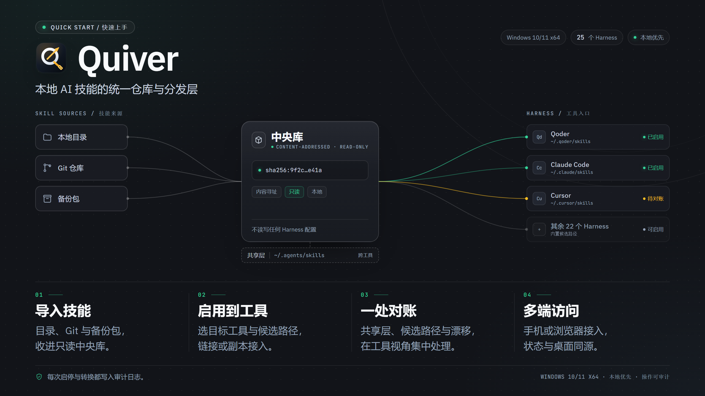
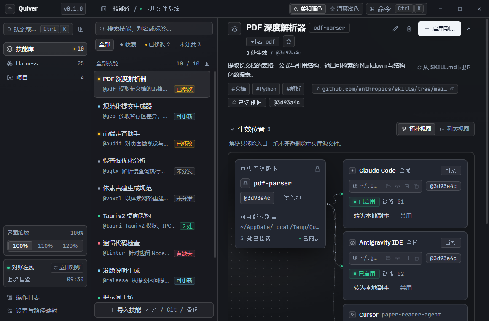
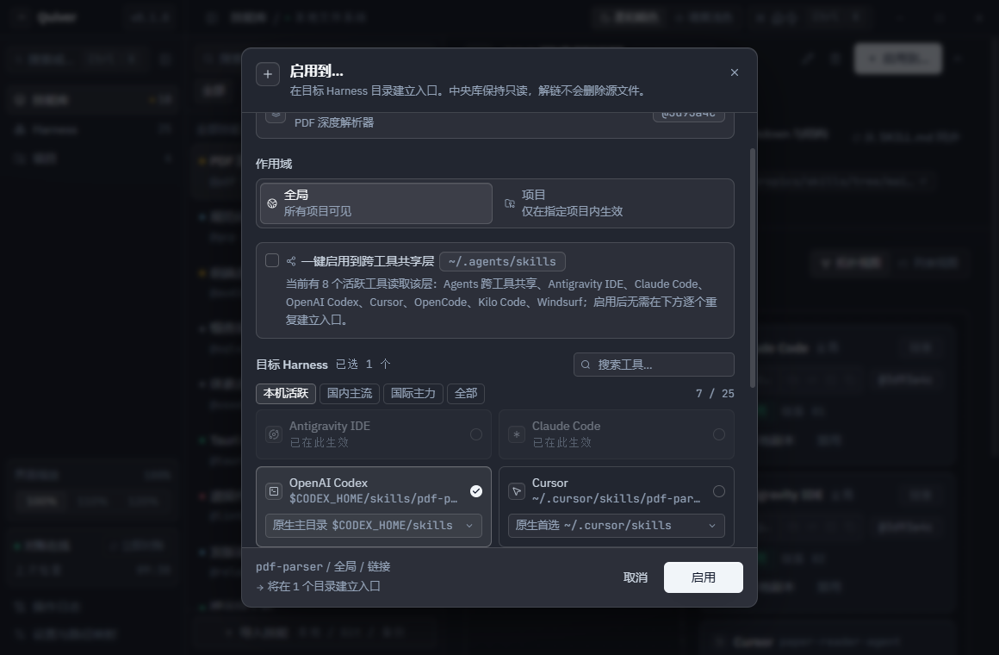
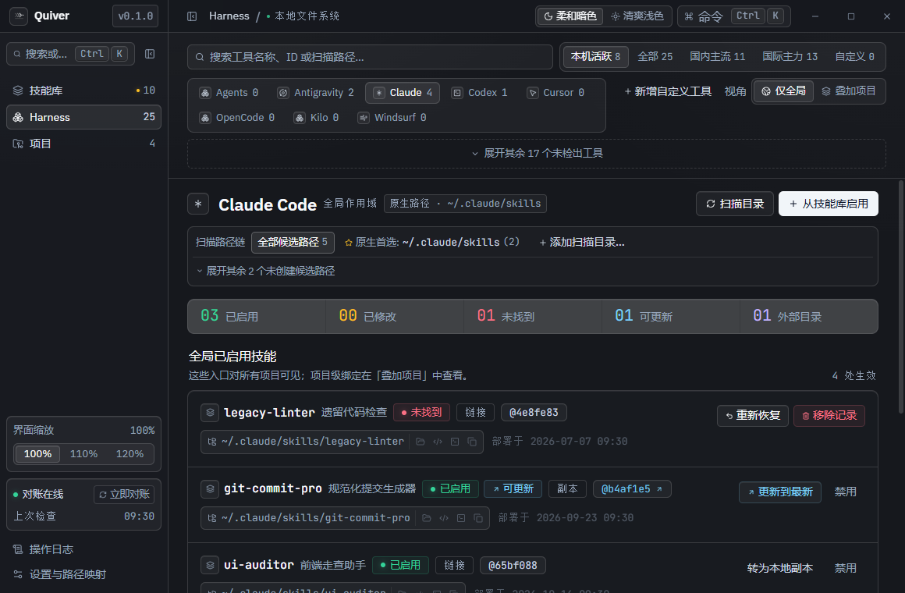
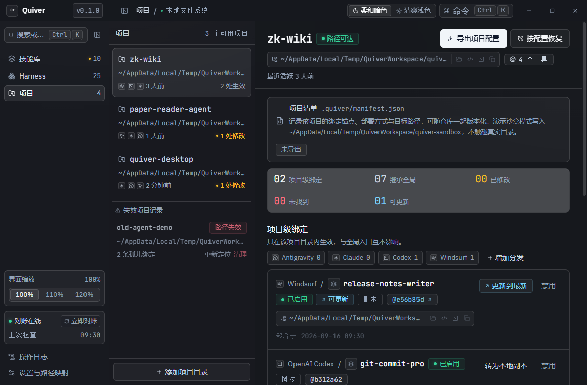
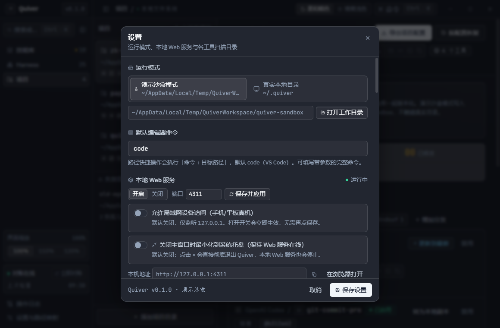
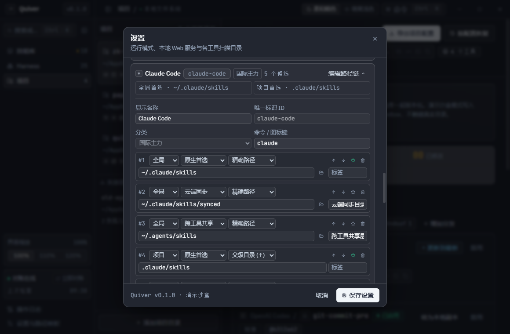
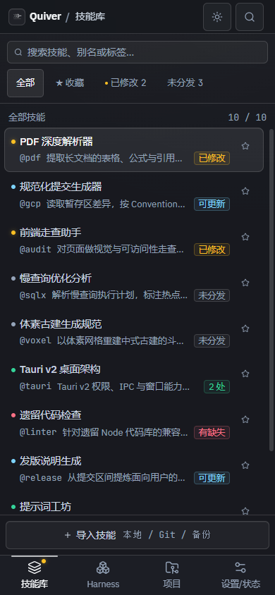
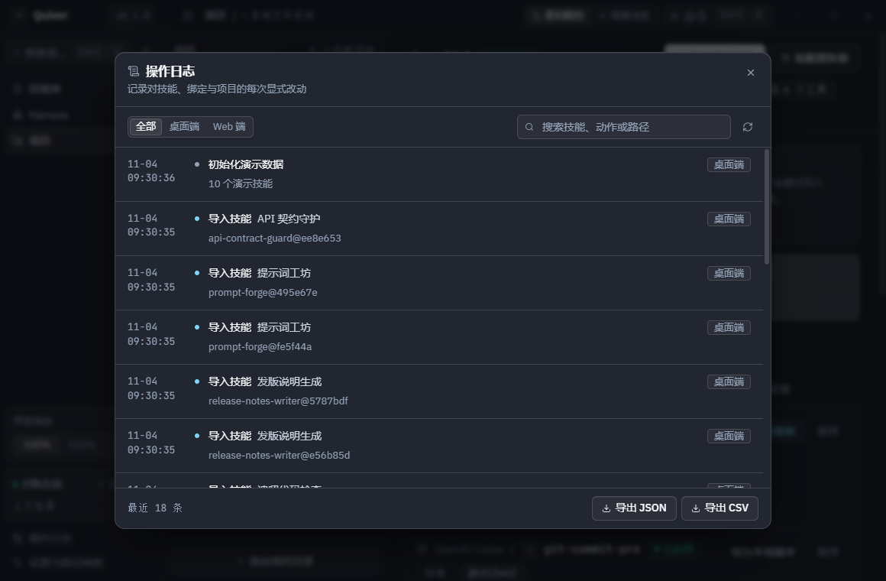

# Quiver 快速上手

> 适用版本：v0.1.0 · Windows 10/11 x64
>
> 本文截图来自**演示沙盒模式**，技能与项目均为演示数据；沙盒不会读写真实的 `~/.quiver` 或 Harness 扫描目录。

## 四步总览

Quiver 把「技能内容」与「部署关系」分开：技能进入只读中央库，Harness 目录只放入口，状态由对账引擎持续校准。整个流程可以按四步走：

1. **导入技能**：目录、Git 仓库或备份包收进中央库，见 [第 3 节](#3-添加技能)。
2. **启用到工具**：选择 Harness 与候选路径，链接或副本接入，见 [第 4 节](#4-把技能启用到工具)。
3. **一处对账**：共享层、候选路径与漂移在工具视角处理，见 [第 5 节](#5-在-harness-视角管理工具) 与 [第 7 节](#7-修改漂移与版本)。
4. **多端访问**：手机或浏览器接入本机 Web 服务，见 [第 9 节](#9-手机与浏览器访问)。

## 1. 下载与启动

从 [Releases](https://github.com/blackteaYES/quiver/releases) 下载任一构建：

| 文件 | 适用场景 |
| :--- | :--- |
| `Quiver-0.1.0-win-x64-setup.exe` | 安装版，创建开始菜单与桌面快捷方式 |
| `Quiver-0.1.0-win-x64-portable.exe` | 便携版，单文件运行，适合放在 U 盘或临时环境 |

Quiver 当前没有配置代码签名。首次运行时若出现 SmartScreen 提示，请点「更多信息 → 仍要运行」；浏览器下载的 exe 也可以先右键 →「属性」→ 勾选「解除锁定」。详细说明（包括 Windows 智能应用控制的限制与 SHA-256 校验）见 [README 的未签名构建说明](../README.md#未签名构建的使用方式)。

首次启动默认使用**真实本地目录** `~/.quiver/`。想先熟悉界面，可在「设置 → 运行模式」切换到「演示沙盒模式」，确认后即可使用演示技能；切换模式不会迁移已有绑定。

## 2. 认识主界面

主窗口由三栏组成：

- **左侧导航**：技能库、Harness、项目，并可打开操作日志与设置；分隔条可拖动调宽，双击收起。
- **中间技能列表**：支持搜索、收藏与「全部 / ★ 收藏 / 已修改 / 未分发」筛选。黄色「已修改」表示某个入口的本地内容已经偏离中央库锚点；「有缺失」表示入口文件不见了。
- **右侧详情**：展示技能简介、标签、中央库版本，以及「生效位置」拓扑。每个入口都会标明工具、作用域（全局 / 项目）、链接或副本，以及当前锚点哈希。

中央库是只读的：详情页的哈希、路径与 `SKILL.md` 预览都只用于查看，「启用到…」只会在 Harness 目录里创建入口。

## 3. 添加技能

点击技能列表底部的「导入技能」，有三种来源：

1. **本地目录**：选择一个包含 `SKILL.md` 的技能目录。
2. **Git 仓库**：填写仓库地址，Quiver 会以 `--depth 1` 浅克隆后导入。
3. **备份包**：导入 Quiver 导出的 JSON 备份，按技能与版本去重合并。

导入时目录树会计算 SHA-256，复制进中央库并固化为只读版本；`.git`、`.DS_Store`、`Thumbs.db`、`desktop.ini` 不参与哈希。含软链接、硬链接或 `..` 越界路径的目录会被拒绝。

如果技能已经在某个 Harness 的扫描目录里，不需要手动导入：到「Harness」视图点「扫描目录」，Quiver 会把不由自己创建的外部技能列出来，可逐项或批量「收编到技能库」（复制进中央库并把原目录替换为链接）或「原地登记」（保留原目录，只纳入受管清单）。

## 4. 把技能启用到工具

选中技能后点右上角「启用到…」：

1. 选择**作用域**：全局对所有项目可见；项目只在指定项目目录内生效。
2. 可选「一键启用到跨工具共享层」（`~/.agents/skills`）：多个工具会同时读取，适合通用技能。
3. 在「目标 Harness」中选择一个或多个工具。已经生效的工具会显示「已在此生效」。
4. 每个工具可以单独选择**写入候选路径**。默认使用该工具优先级最高的候选（P0），也可以在候选链中切换。
5. 底部会汇总「将在 N 个目录建立入口」；确认后点「启用」。

启用默认创建链接（Windows 上是 junction / symlink）。如果某个目录不允许链接，Quiver 会提示并提供副本模式；也可以把已有链接在详情页「转为本地副本」，之后该入口可以自由修改，中央库源内容不受影响。

禁用时只移除入口本身，不会递归删除中央库源目录。共享层入口被禁用时，需要显式选择「仅在当前工具停用（智能拆分）」或「从共享目录彻底移除（所有共用工具同步停用）」。

## 5. 在 Harness 视角管理工具

Harness 视图以工具为主体：

- 顶部按「本机活跃 / 全部 / 国内主流 / 国际主力 / 自定义」筛选；未检出的工具折叠在「展开其余 N 个未检出工具」中。
- 「扫描路径链」展示该工具全部候选路径及优先级。共享层候选存在**不会**被误判为工具已安装；只有原生目录存在或已有绑定才算活跃。
- 「扫描目录」会重新检查文件系统，发现外部技能与缺失入口。
- 下方统计「已启用 / 已修改 / 未找到 / 可更新 / 外部目录」，并列出全局或项目级的生效入口。
- 项目级绑定可通过「叠加项目」查看；工具摘要包含项目级绑定与继承自全局的入口。

同一个 slug 在同一作用域命中多条候选路径时，按优先级遮蔽：优先级最高的标为「当前生效」，其余标为「被高优先级同名目录覆盖」。

## 6. 项目视角

在「项目」视图点「添加项目目录」：

- 项目级绑定只在项目目录内生效，与全局入口互不影响。
- 项目清单 `.quiver/manifest.json` 是可选导出物，默认不会在项目中写文件；点「导出项目配置」才会生成，之后可用「按配置恢复」重建绑定。
- 项目被移走或外接盘拔出后会显示「路径失效」与孤儿绑定。30 秒巡检会在路径恢复后自动重挂；也可以手动「重新定位」。
- 顶部统计会区分「项目级绑定 / 继承全局 / 已修改 / 未找到 / 可更新」，方便判断问题来自项目入口还是全局入口。

## 7. 修改、漂移与版本

Quiver 不会自动合并修改，也不会把本地改动静默写回中央库。入口内容与锚点哈希不一致时，会进入「已修改」状态，并要求显式裁决：

| 裁决 | 行为 |
| :--- | :--- |
| 重置 | 丢弃目标修改，把入口恢复为锚点版本 |
| 收编 | 把目标内容写入只读库作为新版本，并推进绑定 |
| 忽略 | 保留本地分叉，不再持续高亮 |

想长期修改某个技能时，优先把链接「转为本地副本」；想更新中央库版本，就在技能详情或入口行点「更新到最新」。详情页的「历史版本」可以切换激活版本；链接绑定跟随锚点，副本绑定需要显式更新。

## 8. 设置与 Harness 路径字典

「设置」集中管理运行环境：

- **运行模式**：演示沙盒 / 真实本地目录。切换需要二次确认，已有绑定不会跨工作目录迁移。
- **默认编辑器命令**：路径快捷操作会执行「命令 + 目标路径」，默认 `code`。
- **本地 Web 服务**：开关、端口、访问 Token、允许局域网设备访问，以及「关闭主窗口时最小化到系统托盘」。
- **数据与备份**：导出 / 导入完整备份包，包含技能元数据、依赖声明与全部只读版本。

「Harness 路径字典」是 25 个内置工具与自定义工具的唯一配置入口：

- 每个工具可维护多条有序候选路径，分别属于全局 / 项目作用域，角色可为原生首选、共享、兼容、云端同步或自定义。
- 发现方式支持精确路径、父级目录链与 monorepo 子包。
- 编辑器里的 ↑ / ↓ 只调整数组顺序；保存时按数组下标重写 `priority`，`P0` 是新绑定与启用对话框的默认候选。
- 修改候选路径或恢复默认会重新挂载受影响绑定；仍有生效绑定的工具或候选路径不能删除。

## 9. 手机与浏览器访问

桌面端启动后，本地 Web 服务默认只监听 `127.0.0.1:4310`，可在电脑浏览器打开。手机 / 平板访问需要：

1. 在「设置 → 本地 Web 服务」显式开启「允许局域网设备访问（手机/平板真机）」。
2. 使用设置页列出的局域网地址，或扫描带 Token 的二维码。
3. 首次访问会看到 Token 解锁层；Token 只保存在当前浏览器会话的 `sessionStorage`。

二维码与免输直连链接使用 `http://<lan-ip>:<port>/#token=<token>` 形式，页面读取后立即从地址栏清除 Token。重新生成 Token 会让所有已解锁的浏览器会话失效。Web 端不能修改 Web 服务配置，也不能切换运行模式。

手机宽度下，侧栏会变成底部四个 Tab；进入技能或项目详情后，左上角提供「← 返回列表」。触控目标不小于 40px。

## 10. 操作日志

所有对技能、绑定与项目的写操作都会写入审计日志，记录时间、来源（桌面端 / Web 端）、动作与目标。日志是只读的，可以按来源筛选、搜索，并导出 JSON 或 CSV。它不参与业务状态，也不支持在界面里修改或删除单条记录。

## 11. 数据与安全

- 中央库 `store/sha256/` 是内容寻址的只读目录（目录 `0555`、文件 `0444`），相同内容只存一份。
- 禁用或重挂载前先检查目标类型；只删除 symlink / junction 或副本入口，绝不递归删除 Store 源目录。
- 导入拒绝软链接、硬链接与越界路径；备份包会校验 `schema_version`。
- 所有删除技能、清理失效项目、重置漂移、收编外部技能、切换运行模式的操作为显式动作，需要二次确认。
- 真实模式的数据在 `~/.quiver/`；演示沙盒在开发时为 `<repo>/.quiver-demo/`，打包后在 `<userData>/quiver-sandbox/`。

## 常见问题

**双击后提示 Windows 已保护你的电脑**

点「更多信息 → 仍要运行」。也可以右键 exe →「属性」→ 勾选「解除锁定」。如果系统开启了「智能应用控制」，未签名程序通常无法运行，且没有「仍要运行」入口；只能关闭智能应用控制（可能不可逆）或换一台电脑。详见 [README](../README.md#未签名构建的使用方式)。

**Web 服务没有启动，提示端口被占用**

在「设置 → 本地 Web 服务」修改端口并「保存并应用」，或点「自动分配空闲端口并启动」。桌面端可用；Web 端不能修改监听配置。

**忘记访问 Token**

在桌面端「设置 → 本地 Web 服务」查看。重新生成会让旧浏览器会话立即失效；Token 不会出现在快照、SSE、日志或错误消息中。

**技能显示「有缺失」或项目显示「路径失效」**

先确认目标目录或项目盘符是否还在。入口缺失可点「重新部署」；项目路径恢复后 30 秒巡检会自动重挂，也可在项目视图手动处理。

**支持 macOS / Linux 吗**

当前 v0.1.0 只发布 Windows 10/11 x64 构建，没有 macOS / Linux 打包目标。

## 下一步

- [README](../README.md)：完整能力、架构、候选路径矩阵、打包与未签名说明。
- [SPEC](../assets/SPEC.md)：设计规格与实现细节。
- [AGENTS.md](../AGENTS.md)：开发约束与常见坑。
